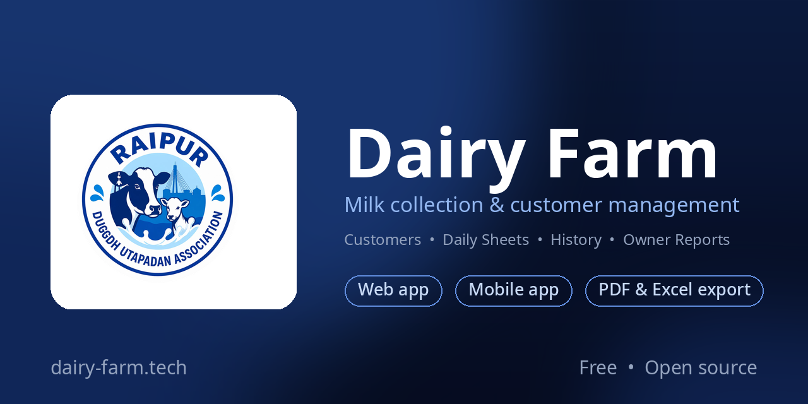

# Dairy Farm

[](https://github.com/Surya-1301/Dairy-Farm/releases)
[](https://www.dairy-farm.tech)
[](https://github.com/Surya-1301/Dairy-Farm/releases)
[](LICENSE)

**Milk collection & customer management for dairy farms — web app + mobile app sharing.**

Track customers, record daily milk entries on an editable sheet, keep sheet history, and get owner-level reporting — from the browser or the Android app.

<div align="center">

| 🌐 Live site | 📱 Android app |
|---|---|
| [dairy-farm.tech](https://www.dairy-farm.tech) | [GitHub releases](https://github.com/Surya-1301/Dairy-Farm/releases) |

</div>

---

## Android app


Dairy Farm is also available as a native Android app, built with Capacitor — the same web app wrapped for mobile, with the same customers, sheets, and history.

📥 **Download:** https://github.com/Surya-1301/Dairy-Farm/releases

- Free forever, no account needed beyond your dairy login
- Same Firebase backend, so data syncs between web and mobile
- Built automatically by GitHub Actions (Capacitor + Gradle), download from Releases

---

## Features

### Web app

<div align="center">

| Screen | What it does |
|---|---|
| Dashboard | Customer count and total milk summary |
| Customers | Add, edit, delete customers; morning/evening shifts shown as one grouped entry |
| Data Sheet | Editable milk sheet (50 rows × 16 days default); add/remove rows and day columns; combined morning + evening totals |
| History | Saved sheet snapshots — export to PDF/Excel, rename, delete |
| Archived Sheets | Past sheets kept editable without touching the live sheet |
| Profile | Name, phone, avatar upload, password reset |
| Owner Dashboard | All users, milk totals, earnings; edit any profile; view/export/delete any user's sheets; reset passwords |

</div>

### Mobile app

The Android app is the same web app wrapped with Capacitor — identical screens (Dashboard, Customers, Data sheet, History, Profile, Owner Dashboard) talking to the same Firebase backend.

### Sheet workflow

- **Save to History** — snapshots the current sheet without changing it
- **Archive** — stores the current sheet as an archived entry and starts a fresh sheet with the same customer structure
- **History** — rename, export (PDF/Excel), or delete any snapshot

---

## How it works

**Shared Firebase backend.** Both apps read and write the same Firestore collections, so a sheet updated on the phone shows up on the web instantly (real-time listeners).

**Authentication.** Firebase Auth (email/password + Google sign-in). The owner account is determined by `VITE_OWNER_EMAIL` and gets exclusive access to the Owner Dashboard.

**Avatars.** Uploaded to Cloudinary (unsigned preset) on profile save; the secure URL is stored in Firestore.

**Password reset.** A small Node server (`reset-server/`) mints a real Firebase reset `oobCode`; EmailJS sends the branded reset email — no Firebase Blaze plan needed.

---

## Tech Stack

### Web app (`frontend/`)

- **React 18** + **TypeScript** + **Vite 5**
- **Tailwind CSS 3** · **React Router 6** · **Recharts**
- **Firebase 10** (Auth + Firestore)
- `jspdf` + `jspdf-autotable`, `exceljs` — PDF/Excel export
- Cloudinary REST API — avatar uploads

### Android app (Capacitor wrapper around `frontend/`)

- **Capacitor 8** — `capacitor.config.ts` (`appId: com.dairyfarm.app`)
- GitHub Actions workflow (`.github/workflows/android.yml`) builds a debug APK on manual trigger

### Reset server (`reset-server/`)

- **Node.js** — mints Firebase password-reset links via the Admin SDK

---

## Project Structure

```txt
Dairy-Farm/
├─ frontend/                 # Web app (React + Vite + Tailwind)
│  ├─ src/pages/            # Login, Dashboard, Customers, CustomerDetails,
│  │                         # History, Profile, OwnerDashboard, ResetPassword
│  ├─ src/components/       # Layout, BottomNav, CustomerTable, SummaryTable, Chart
│  ├─ src/firebase/         # Auth, Firestore data layer, config
│  └─ src/utils/            # milkData, customerData, cloudinary, emailOtp, theme
├─ reset-server/             # Standalone reset-link server (Render)
├─ DEPLOYMENT.md             # Firebase + hosting deployment guide
└─ README.md                 # This file
```

---

## Getting Started

### Web app

```bash
cd frontend
npm install
```

Create `frontend/.env` (see `.env.example` at the repo root):

```env
VITE_FIREBASE_API_KEY=your_api_key
VITE_FIREBASE_AUTH_DOMAIN=your_project.firebaseapp.com
VITE_FIREBASE_PROJECT_ID=your_project_id
VITE_FIREBASE_STORAGE_BUCKET=your_project.appspot.com
VITE_FIREBASE_MESSAGING_SENDER_ID=your_sender_id
VITE_FIREBASE_APP_ID=your_app_id
VITE_OWNER_EMAIL=owner@example.com
VITE_CLOUDINARY_CLOUD_NAME=your_cloud_name
VITE_CLOUDINARY_UPLOAD_PRESET=your_unsigned_upload_preset
VITE_EMAILJS_SERVICE_ID=your_emailjs_service_id
VITE_EMAILJS_TEMPLATE_ID=your_emailjs_otp_template_id
VITE_EMAILJS_RESET_TEMPLATE_ID=your_emailjs_reset_template_id
VITE_EMAILJS_PUBLIC_KEY=your_emailjs_public_key
VITE_RESET_SERVER_URL=https://your-reset-server.onrender.com
```

```bash
npm run dev      # start dev server (localhost:5173)
npm run build    # production build → dist/
```

### Build the Android APK

GitHub repo → **Actions** → **Android APK** → **Run workflow**. The workflow builds the web app, syncs Capacitor, and uploads the debug APK as the `dairy-farm-debug-apk` artifact. Attach it to a GitHub Release to update the download link above.

Android package id: `com.dairyfarm.app`

---

## Deployment

Deploy `frontend/dist/` to Vercel, Netlify, Firebase Hosting, or any static host. The reset server deploys as a free Render Web Service. Full walkthrough in [`DEPLOYMENT.md`](DEPLOYMENT.md).

---

## Privacy

- Customer and milk data lives in your own Firebase project — no third-party analytics on user data
- Avatar images go to your own Cloudinary cloud
- Password-reset emails are sent via your own EmailJS account

---

## License

MIT — see [LICENSE](LICENSE).
